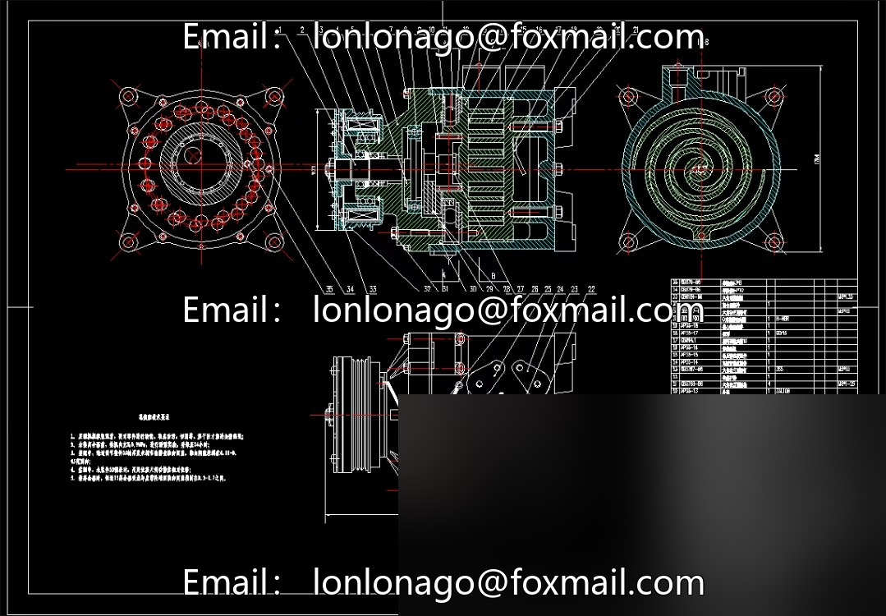
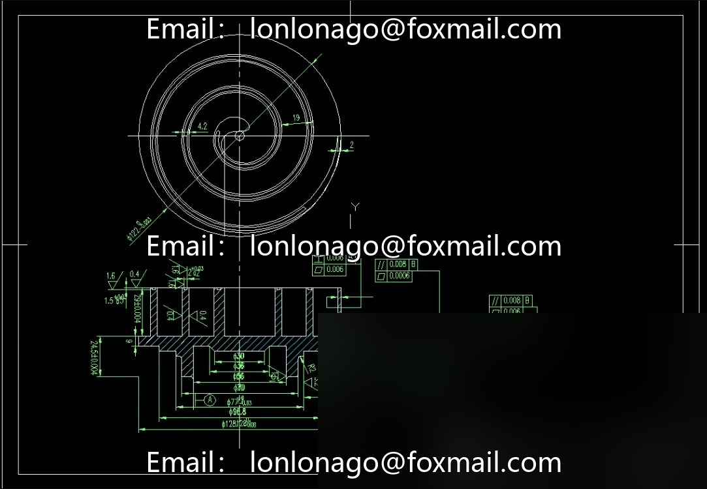

# Wound-type compressor design; air conditioning wound-type compressor design; automobile air conditioning wound-type compressor design

## Body

Swept-component compressor design; AC swept-component compressor design; auto AC swept-component compressor design
The material includes CAD drawings (assembly drawing + static swept body + dynamic swept body) + manual
The manual centers on the design and verification of the swept-component compressor for automobiles. Since the force acting on the swept body of a swept-component compressor not only affects the strength, rigidity, friction, and wear of components but also affects the thermal performance and power characteristics of the compressor, it is necessary to conduct force analysis and strength, rigidity verification on some important motion parts of the designed swept compressor. These forces include gas force, inertial force, and friction force, and the effect of friction is extremely small and can be ignored; thus, this article only analyzes and calculates the gas force and inertial force. The final conclusion is that the designed compressor meets the requirements. 524

The material includes design and CAD drawings (assembly, static vortex body and dynamic vortex body) plus instructions on auto air-conditioning vortex compressor design and verification, covering force analysis and strength/stiffness checks.

<!-- AI_ENRICHED -->

## Images

## Payment

Here is a pay link on Stripe ( https://buy.stripe.com/3cs8yP7sY87d0vu9AB ). Please contact me lonlonago@foxmail.com after funding $89, and I will send you a complete data files , thank you!

